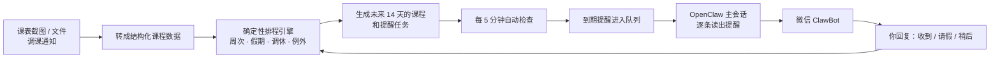

<div align="center">

# ⏰ 上课提醒智能体

**把课表交给它，它会在正确的时间，通过微信提醒你去上课。**

基于 **OpenClaw + DeepSeek** 的自动上课提醒系统  
支持单双周、节假日、调休、临时停课、调课、换教室和天气变化


[快速部署](#-快速开始) · [部署指南](DEPLOY.md) · [功能一览](#-功能一览) · [工作原理](#-工作原理)

</div>

---

## 这是什么？

这是一个真正跑在 OpenClaw 上的上课提醒智能体。

你只需要导入一次课表，它就会：

1. 算好每一节课的实际上课日期；
2. 在前一晚、出门前和上课前分三次提醒；
3. 遇到停课、调课或换教室时，自动按新安排提醒；
4. 下雨或恶劣天气时，适当提前出门提醒；
5. 把提醒直接发到微信，不需要你反复打开课表确认。

> 本项目为大学生科研训练计划（SRTP）课题《基于 OpenClaw 的上课提示智能体开发》。

仓库中的课程是**示例数据**，不包含开发者本人的真实课表。部署时换成自己的课表即可。

---

## 微信里是什么样？

提醒会通过微信里的「ClawBot」联系人发来：

```text
🌙 明天预告｜大学英语 10:00 在外语楼205｜带：英语书

🎒 该出门了｜大学英语 10:00 在外语楼205｜带：英语书

⏰ 快上课了｜大学英语 10:00 在外语楼205｜带：英语书
```

收到后可以直接回复：

| 你的回复 | 系统会怎么做 |
|---|---|
| `收到` | 标记已确认，不再追问 |
| `今天请假，不去了` | 取消这节课后续的提醒 |
| `10分钟后再提醒我` | 延后 10 分钟重新提醒 |
| `明天有什么课？` | 查询明天的课程安排 |
| `课前提前20分钟提醒` | 修改提醒设置 |

---

## 功能一览

| 功能 | 说明 |
|---|---|
| 📅 **课表导入** | 支持文字、CSV、Excel、JSON；课表截图可先转成文字再导入 |
| 🌐 **网页导入课表** | 在本地配置页面的「导入课表」里上传文件或粘贴文字，先预览再确认导入，不用敲命令 |
| 🔀 **单双周与调休** | 正确处理单周、双周、指定周次、节假日和调休补课 |
| 📣 **调课通知解析** | 把“停课、改到周五、换到 301、改线上”等通知变成单次例外 |
| ⏰ **三级提醒** | 前晚预告 → 出门提醒 → 课前提醒 |
| 🌦️ **天气提前** | 下雨或恶劣天气时，出门提醒会自动增加提前量 |
| 💬 **对话查询** | 可以问“明天有什么课”“下节课在哪上”“高数要带什么” |
| ⚙️ **对话改设置** | 用一句话调整提醒时间、提前量、静默时段或关闭某类提醒 |
| 🖥️ **本地配置页面** | 在浏览器里查看课程、修改提醒设置和发送渠道 |
| 💚 **微信自动投递** | 通过 OpenClaw 官方微信插件和主会话通道自动发送 |
| 🛡️ **过期提醒作废** | 关机几天后重新开机，不会把早已过期的提醒一股脑补发 |

---

## 工作原理



### 最重要的一条原则：时间不能让大模型猜

| 工作 | 谁负责 |
|---|---|
| 第几周、单双周、假期、调休、提醒时间、状态流转 | **确定性 Python 代码** |
| 把截图或通知原文转成文字 | 智能体 / LLM |
| 提醒措辞 | 模板为主，LLM 只做辅助 |

这样可以避免模型把日期、教室或上课时间“算错”或编出来。所有核心逻辑都有单元测试覆盖。

### 另外三条安全原则

- **不猜数据**：课程、日期、教室或老师识别不准时，标记为“待确认”，不擅自补全。
- **先预览，后写入**：导入课表、解析通知和修改配置时，默认只显示预览；确认后才真正写入。
- **密钥不进仓库**：API Key 和 webhook 地址只放在环境变量或本机忽略文件中。

---

## 快速开始

### 只想在本地体验

只需要 Python 3.10 或更高版本，项目核心只使用 Python 标准库，不需要额外 `pip install`。

```bash
# 1. 运行全部测试
python3 -m unittest discover -s tests

# 2. 预览一次提醒计算，不真正发送
python3 scripts/run_scheduler.py --tick --now 2026-09-13T21:00:00+08:00

# 3. 导入示例课表（先预览）
python3 scripts/import_timetable.py examples/sample_timetable.txt
```

确认预览没问题后，再加 `--apply` 写入：

```bash
python3 scripts/import_timetable.py examples/sample_timetable.txt --apply
```

### 部署成微信自动提醒

完整流程见 **[DEPLOY.md](DEPLOY.md)**。简单来说只有三步：

#### 1. 安装 OpenClaw 和微信插件

完成 OpenClaw 的初始化，安装官方 `openclaw-weixin` 插件，并扫码登录微信 ClawBot。

#### 2. 放入项目并导入自己的课表

把本项目放到 OpenClaw 的 workspace 中，然后导入自己的课表，替换仓库里的示例数据。

#### 3. 运行一键部署脚本

```bash
python3 scripts/deploy_setup.py
```

它会检查环境、设置微信主会话投递渠道，并创建每 5 分钟运行一次的自动提醒任务。

最后，给微信里的 ClawBot 随便发一条消息刷新投递令牌。等当晚 21:00 的前晚预告自动出现，就说明部署成功了。

---

## 常用操作

### 导入课表

```bash
# 预览
python3 scripts/import_timetable.py my_timetable.txt

# 确认后写入
python3 scripts/import_timetable.py my_timetable.txt --apply
```

支持 `.txt`、`.csv`、`.xlsx` 和 `.json`。详细规则见 `skills/timetable-import/SKILL.md`。

也可以不用命令行：打开本地配置页面（见下文），在「导入课表」页上传文件或粘贴文字，预览核对后点「确认导入」即可，行为与命令行完全一致。

### 解析调课或停课通知

```bash
python3 scripts/parse_notice.py "大学英语 2026年9月16日的课改到周五线上上课"
python3 scripts/parse_notice.py "高等数学 2026年9月21日停课一次" --apply
```

通知只影响对应的那一次课，不会改掉整学期的周期课表。

### 查询课表

```bash
python3 scripts/ask.py "明天有什么课"
python3 scripts/ask.py "高等数学什么时候上"
python3 scripts/ask.py "下节课是什么"
```

### 修改提醒设置

```bash
python3 scripts/configure.py "课前提前20分钟提醒"
python3 scripts/configure.py "关掉前晚提醒" --apply
python3 scripts/configure.py "我现在的提醒设置是怎样的"
```

### 打开本地配置页面

```bash
python3 scripts/serve_ui.py
```

然后在浏览器打开 `http://127.0.0.1:8765/`。

页面包含总览、提醒设置、单课覆盖、未来课程、发送渠道和导入课表六部分。

> ⚠️ 配置页面没有登录验证，只绑定本机 `127.0.0.1`，不要暴露到局域网或公网。

---

## 项目结构

```text
class-reminder-agent/
├── README.md                 # 你正在看的说明
├── DEPLOY.md                 # 已验证的完整部署指南
├── SOUL.md / AGENTS.md       # OpenClaw 智能体设定与工作规则
├── HEARTBEAT.md              # 自动检查时的执行协议
├── config/                   # OpenClaw 示例配置
├── data/                     # 学期、课程、例外和用户设置
├── examples/                 # 示例课表
├── skills/                   # 课表导入、通知解析、查课、改设置等操作规程
├── src/                      # 确定性核心、发送层、天气、查询和 Web UI
├── scripts/                  # 命令行入口与一键部署脚本
├── ui/                       # 本地配置页面
└── tests/                    # 302 个自动化测试
```

---

## 发送方式

系统支持多种发送通道，可以在本地配置页面或设置文件中切换：

| 通道 | 用途 |
|---|---|
| `console` | 打印到终端，适合调试 |
| `outbox` | 写入本地 JSONL 文件，适合本地验证 |
| `webhook` | 发送到企业微信机器人或第三方推送服务 |
| `gateway` | 通过自定义 OpenClaw 网关命令发送 |
| `session` | **微信 ClawBot 正式部署使用**：由主会话逐条读出并确认回写 |
| 备用兜底（session 专用） | session 任务排队超过 `fallbackAfterMin` 分钟（默认 15）仍未确认送达时，自动改走 Server酱 / PushPlus 补发，见下方说明 |

**备用兜底（session 通道专用）**：主会话投递依赖微信的 context token，而 token
只能靠用户主动发消息刷新——过夜没互动后，早晨第一条出门提醒会排着队却送不出去
（2026-10-28 实测迟到 50 分钟，token 刷新后才积压送达）。在「发送渠道」页开启备用
通道（Server酱或 PushPlus，填 key、设 `fallbackAfterMin`，默认 15 分钟）后：一条
提醒从第一次排队起超过该分钟数还没被确认送达，调度器会在 tick 内部自动改走备用
通道补发，成功即标记 `sent`（channel 记为 `fallback:serverchan` 等，审计可查）；
补发失败则仍保留在主会话队列里继续朗读，每个重排周期最多重试一次。不开启
（默认）或没填 key 时，行为与之前完全一致。

<details>
<summary><b>为什么微信提醒要走“主会话”？</b></summary>

在真实 OpenClaw 环境中测试发现，直接使用命令行发送微信消息会被 iLink 以
`sendMessage ret=-3 invalid arguments` 拒绝，因为该路径没有携带入站消息下发的
context token。

目前验证可行的方法是：

1. 定时任务唤醒主会话中的智能体；
2. 智能体运行调度器，把到期提醒加入队列；
3. 智能体在微信对话中逐条原样读出提醒；
4. 再运行确认命令，把任务状态从 `queued` 回写为 `sent`。

这样既能使用微信的会话投递通道，也能保留明确的发送状态。完整背景和部署细节见
[DEPLOY.md](DEPLOY.md)。

</details>

---

## 数据说明

| 文件 | 内容 |
|---|---|
| `data/term.json` | 学期开始日期、总周数、假期、调休和每节课的时间 |
| `data/courses.json` | 周期课程模板 |
| `data/exceptions.json` | 某一次课的停课、调课、换教室或线上安排 |
| `data/user.json` | 提醒时间、提前量、静默时段等个人偏好 |
| `data/occurrences.json` | 系统生成的未来课程实例 |
| `data/reminders.json` | 系统生成的提醒任务和发送状态 |

其中 `occurrences.json` 和 `reminders.json` 是运行生成文件，不需要手工维护。

---

## 测试

```bash
python3 -m unittest discover -s tests
```

当前共 **302 个测试**，覆盖：

- 周次、单双周、假期和调休计算；
- 课表与调课通知解析；
- 提醒生成、发送、确认、请假和延后；
- 天气提前量；
- 对话查课与修改设置；
- Web 配置页面；
- 微信主会话两阶段投递；
- session 备用通道兜底（token 失效时经 Server酱/PushPlus 补发）；
- 过期提醒作废与时间时区处理；
- 一键部署脚本。

测试只使用临时数据和本地假服务，不会向真实地址发送测试消息。

---

## 当前进度

### 已完成

- [x] 确定性课表展开与三级提醒调度
- [x] 课表导入与调课/停课通知解析
- [x] 回复确认、请假、延后和未确认追问
- [x] 天气预报驱动的出门提前量
- [x] 对话查询课表与修改提醒设置
- [x] 本地 Web 配置页面
- [x] OpenClaw + 微信 ClawBot 真实部署
- [x] 每 5 分钟全自动提醒
- [x] 真实个人课表导入并投入使用
- [x] 一键部署脚本与完整部署文档
- [x] 过期提醒自动作废

### 后续计划

- [ ] 接入更完整的 DeepSeek 自然语言理解链路
- [ ] 增加语音交互
- [ ] 研究教务系统直接获取课表与内置 OCR
- [ ] 做提醒准确率与解析准确率评测
- [ ] 完成正式需求、设计和测试文档
- [ ] 制作演示视频并完成 SRTP 结题材料

---

## 一句话总结

**课表负责告诉系统“有什么课”，确定性代码负责算清“什么时候提醒”，OpenClaw 和微信负责把提醒准时送到你手上。**
